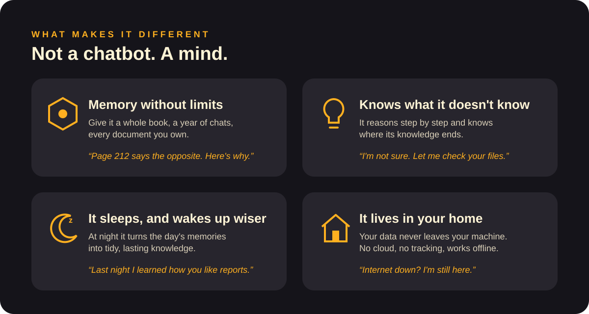
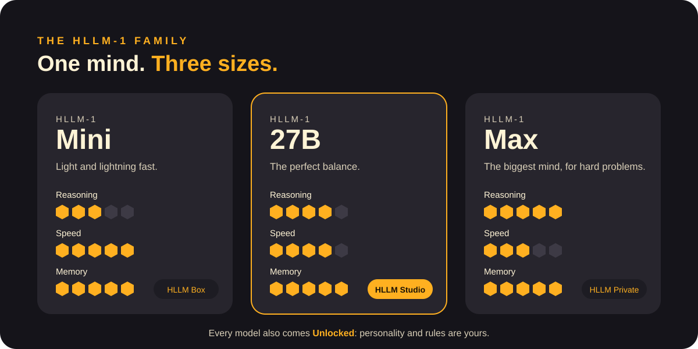

  

  <a href="README.md">English</a> · <b>Italiano</b>
  &nbsp;|&nbsp;
  <a href="docs/what-is-hllm.md">Cos'è HLLM</a> ·
  <a href="docs/models.md">Modelli</a> ·
  <a href="docs/machines.md">Macchine</a> ·
  <a href="docs/hllm-os.md">HLLM OS</a> ·
  <a href="docs/faq.md">FAQ</a>

> **HLLM Vision.** Ecco dove sta andando HoneyLabs: la mente, le macchine e la casa che stiamo costruendo.

---

## Una mente che vive con te

HLLM non è l'ennesimo chatbot nel cloud. È una **mente digitale che vive su una macchina a casa tua**. Ricorda tutto quello che le dici, ragiona prima di rispondere, lavora per te mentre sei fuori e **la notte dorme**, per trasformare la giornata in conoscenza.

## Cosa la rende diversa

| | Assistente AI tipico | **HLLM** |
|---|---|---|
| Dove vive | Sui server di altri | **A casa tua** |
| Quanto ricorda | Una conversazione, poi dimentica | **Tutto, per anni** |
| Quando non sa | Spesso inventa | **Lo dice, poi verifica** |
| I tuoi dati | Possono addestrare modelli | **Non escono mai dalla tua macchina** |
| Senza internet | Si ferma | **Continua a lavorare** |
| Personalità | Fissa | **La decidi tu (Unlocked)** |

## Standard o Unlocked?

Ogni modello HLLM esiste in due versioni. **Standard** è gentile, attento e segue regole sicure pensate per tutti. **Unlocked** lascia a *te* la scelta di personalità, tono e regole.

Unlocked gira solo sulle macchine HLLM **di tua proprietà**, per uso privato domestico. → [Modelli](docs/models.md)

## La famiglia

- **HLLM-1 Mini**: leggera e velocissima, per ogni giorno.
- **HLLM-1 27B**: l'equilibrio perfetto fra mente e velocità.
- **HLLM-1 Max**: la mente più grande, per i problemi più difficili.

## Le macchine

Compri la macchina e la mente è tua: **nessun abbonamento per il modello, 5 anni di aggiornamenti di sicurezza inclusi**. Non vuoi un'altra macchina in casa? Ogni macchina è disponibile anche **in abbonamento**, protetta da crittografia end-to-end e da codici che cambiano ogni pochi secondi. → [Macchine](docs/machines.md) · [Sicurezza e privacy](docs/security-and-privacy.md)

## HLLM OS

Ogni macchina usa **HLLM OS**, costruito intorno alla mente:
- si collega alla tua **casa smart**;
- fa **ricerche sul web** per te;
- avvia **agenti** che finiscono i lavori mentre sei fuori;
- manda sul telefono **schermate effimere**: compaiono quando serve il tuo OK o un lavoro è finito, poi spariscono.

## In numeri

## Dentro HLLM

Quattro parti lavorano come una sola:
- **Harness** parla con te e usa gli strumenti;
- **Brain** ricorda e dorme;
- **Engine** fa girare velocemente una mente grande in casa;
- **HLLM-1** è la mente stessa.

## Partecipa

- 💡 **Idee**: apri una [discussione](../../discussions) e raccontaci cosa dovrebbe fare il tuo HLLM.
- 🐞 **Qualcosa non va in queste pagine?** [Apri una segnalazione](../../issues/new/choose).
- 📖 **Documentazione e guide**: [inizia da qui](docs/README.md). Le pagine di dettaglio sono in inglese.

---

  HLLM Vision di <b>HoneyLabs</b> · pagine e immagini sotto <a href="LICENSE">CC BY-NC 4.0</a> · questo repository non contiene codice sorgente.

