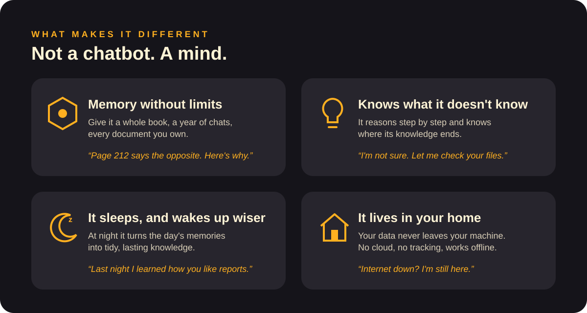
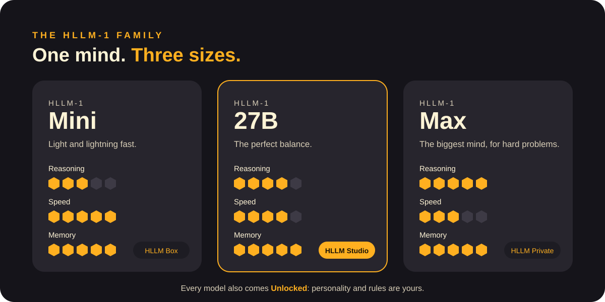

  

  <b>English</b> · <a href="README.it.md">Italiano</a>
  &nbsp;|&nbsp;
  <a href="docs/what-is-hllm.md">What is HLLM</a> ·
  <a href="docs/models.md">Models</a> ·
  <a href="docs/machines.md">Machines</a> ·
  <a href="docs/hllm-os.md">HLLM OS</a> ·
  <a href="docs/faq.md">FAQ</a>

> **HLLM Vision.** This is where HoneyLabs is heading: the mind, the machines and the home we are building.

---

## A mind that lives with you

HLLM is not another chatbot in the cloud. It is a **digital mind that lives on a machine in your home**. It remembers everything you tell it, reasons before it answers, works for you while you are away, and **sleeps at night** to turn the day into knowledge.

## What makes it different

| | Typical AI assistant | **HLLM** |
|---|---|---|
| Where it lives | Someone else's servers | **Your home** |
| How much it remembers | One conversation, then it forgets | **Everything, for years** |
| When it doesn't know | Often makes something up | **Says so, then checks** |
| Your data | Can be used to train models | **Never leaves your machine** |
| Without internet | Stops | **Keeps working** |
| Personality | Fixed | **Yours to shape (Unlocked)** |

→ [More: what is HLLM, explained for everyone](docs/what-is-hllm.md)

## Standard or Unlocked?

Every HLLM model comes in two versions. **Standard** is kind, careful and follows safe rules made for everyone. **Unlocked** lets *you* choose personality, tone and rules.

Unlocked runs only on HLLM machines **you own**, for private home use. → [Models](docs/models.md)

## The family

- **HLLM-1 Mini**: light and lightning fast, for every day.
- **HLLM-1 27B**: the perfect balance between mind and speed.
- **HLLM-1 Max**: the biggest mind, for the hardest problems.

## The machines

Buy your machine and the mind is yours: **no subscription for the model, 5 years of security updates included**. Prefer not to own hardware? Every machine is also available **by subscription**, protected by end-to-end encryption and codes that change every few seconds. → [Machines](docs/machines.md) · [Security & privacy](docs/security-and-privacy.md)

## HLLM OS

Each machine runs **HLLM OS**, built around the mind. It connects to your **smart home**, does **research on the web** for you, runs **agents** that finish tasks while you're out, and sends **ephemeral screens** to your phone: they appear when your OK is needed or a job is done, then vanish.

→ [HLLM OS](docs/hllm-os.md)

## In numbers

## Inside HLLM

Four parts work as one: **Harness** talks with you and uses tools, **Brain** remembers and sleeps, **Engine** makes a big mind run fast at home, and **HLLM-1** is the mind itself. → [Brain: memory and sleep](docs/brain.md)

## Join us

- 💡 **Ideas**: open a [discussion](../../discussions) and tell us what your HLLM should do.
- 🐞 **Something wrong on these pages?** [Open an issue](../../issues/new/choose).
- 📖 **Docs & guides**: [start here](docs/README.md).

---

  HLLM Vision by <b>HoneyLabs</b> · pages and images under <a href="LICENSE">CC BY-NC 4.0</a> · this repository contains no source code.

