# HLLM documentation

Everything about HLLM, written for everyone. No technical background needed.

| Page | What you'll find |
|---|---|
| [What is HLLM](what-is-hllm.md) | What an AI model is, and why HLLM is a mind, not a chatbot |
| [Models](models.md) | The HLLM-1 family, Standard vs Unlocked |
| [Machines](machines.md) | HLLM Box, Studio and Private: buy or subscribe |
| [HLLM OS](hllm-os.md) | Smart home, web research, agents, ephemeral screens |
| [Brain](brain.md) | How HLLM remembers, finds and sleeps |
| [Security & privacy](security-and-privacy.md) | Encryption, rotating codes, your data stays yours |
| [Updates & licensing](updates-and-licensing.md) | 5 years of security updates, no model subscription |
| [Guides](guides/README.md) | First steps, setup and everyday use |
| [FAQ](faq.md) | Quick answers |

[← Back to home](../README.md)
