<b>English</b> · <a href="../it/brain.md">Italiano</a>

# Brain: memory and sleep

**HLLM Brain** is the part of HLLM that remembers. It works like human memory, in layers:

| Layer | Like in people | In HLLM |
|---|---|---|
| **Core** | Who you are | Its identity, its rules, the tools it can use: always present |
| **Working memory** | What you're thinking about now | The latest part of the conversation, in sharp focus |
| **Archive** | Everything you've lived | Documents and past conversations, found again when needed |
| **Sleep** | Sleeping on it | At night, the day becomes tidy, lasting knowledge |

## A whole book in seconds

Give HLLM a document as long as a book. It skims it the way you would: beginning, end, and the passages that matter for your question. The first word of the answer arrives in about **7 seconds**.

## No context limit

Most models have a fixed "context": past a certain length, they forget the beginning. HLLM's Brain keeps everything in its archive and brings back what matters, so the conversation never has to end.

[← Documentation](README.md)
