<b>English</b> · <a href="../it/machines.md">Italiano</a>

# Machines

| | HLLM Box | HLLM Studio | HLLM Private |
|---|---|---|---|
| Mind | HLLM-1 Mini | HLLM-1 27B | HLLM-1 Max |
| Size | Like a book | Compact tower | Dedicated server |
| Graphics | Integrated | 16 GB graphics card | Data-center class |
| Buy it | ✓ | ✓ | |
| Subscribe | ✓ | ✓ | ✓ |
| Unlocked models | When owned | When owned | |

## Buy or subscribe

**Buy it** and the machine is yours: no subscription for the model, 5 years of security updates included, and access to Unlocked models.

**Subscribe** and we keep a machine ready for you. It is a **dedicated machine, never shared** with anyone else. It is not "the cloud": your data is encrypted end to end and only your app and your machine can read it. Subscriptions run Standard models only.

## Every machine runs HLLM OS

The same operating system on every model: smart home, web research, agents and ephemeral screens on your phone. → [HLLM OS](hllm-os.md)

[← Documentation](README.md)
