<b>English</b> · <a href="../it/security-and-privacy.md">Italiano</a>

# Security & privacy

- **Your data stays home.** On a machine you own, nothing you say leaves it unless you ask HLLM to search the web.
- **Never used for training.** Your conversations and files never train any model, ours included.
- **End-to-end encryption.** Between your phone or computer and your machine, everything is encrypted. Only your app and your machine hold the keys.
- **Rotating codes.** Every connection needs a code that changes every few seconds on both your app and your machine. Without it, the connection does not start.
- **Dedicated, never shared.** A subscribed machine belongs to you alone for the whole subscription.
- **5 years of security updates** for every machine you buy.
- **Unlocked responsibly.** Unlocked models run only on machines you own, for private home use.

[← Documentation](README.md)
