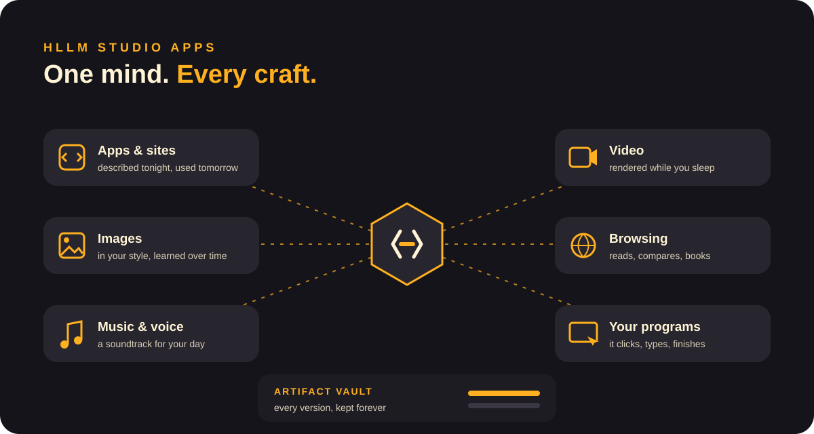

<b>English</b> · <a href="../it/studio-apps.md">Italiano</a>

# HLLM Studio Apps: one mind, every craft

HLLM is not one app. It is **one mind that changes craft**: it builds, draws, composes, films, browses and uses your programs. Every app shares the same memory, the same taste, the same you.

## The crafts

| | What you say | What you get |
|---|---|---|
| **Apps & sites** | "I need an app to track my plants." | A working app on your phone tomorrow morning. It keeps improving as you use it. |
| **Images** | "A logo for my bakery, warm, a bit retro." | Ten options in your style, refined from your favourites. |
| **Music & voice** | "Something calm for working, like last Sunday." | An endless soundtrack that follows your day. |
| **Video** | "Turn our holiday photos into a two-minute film." | Edited, scored and narrated, ready when you wake up. |
| **Browsing** | "Find a flight under €200 and book it if it's direct." | Compared, chosen, booked. It asks you only for the final OK. |
| **Your programs** | "Put these receipts into my spreadsheet." | It opens the program, clicks, types and finishes the job. |

## The Artifact Vault

Everything HLLM creates is kept, **every version, forever**, on your machine.
> "Bring back the logo from March, but warmer."

It's version control for your whole creative life.

## Dream mode

At night the graphics card is free, so HLLM uses it. It finishes long renders and polishes your projects, and prepares **surprises** for the morning:
- a 60-second film of your week;
- a song made from today's notes;
- the app you described at dinner, ready to try.

## Ideas we are chasing

- **Living apps.** The apps HLLM builds for you watch how you use them and evolve overnight. Unused buttons disappear, missing ones appear.
- **Show it once.** Do a task once while HLLM watches. It understands the steps and does it for you from then on.
- **Your home as a canvas.** Lights, music and screens follow the mood of the room, composed live.
- **Agent swarms.** One question, a hundred tiny HLLM agents in parallel during the night, each exploring a different idea. In the morning you get the three best.
- **A personal course from any book.** Give it a book. It builds lessons, quizzes, diagrams and short videos at your pace.
- **Make a game, play it tonight.** Describe it at lunch, play it after dinner, and ask for changes while you play.
- **Family minds that talk.** The HLLMs of a household plan a dinner or a trip together. They share only what you allow, and nothing ever leaves your home.
- **Skills, not data.** Share a skill your HLLM learned, like "how I edit podcasts", with friends, without sharing a single file.
- **A second brain on the wall.** A calm e-ink screen at home: today's plan, what HLLM is working on, what needs you.
- **Repair companion.** Point the phone camera at the broken thing and get step-by-step help, with arrows drawn on the image.
- **Time-travel for everything.** Any document, any project, any setting: "how was it last Tuesday?"
- **One brain, many screens.** Start a task on the TV, continue on the phone, finish at the desk. The mind follows you, not the device.

## How it's possible on one machine

One graphics card has to be both the **mind** and the **creative studio**, and HLLM conducts the whole orchestra. When an image or a video is needed, the mind steps aside and lends the card, then takes it back. Long jobs run in the quiet hours, and you get an ephemeral screen when something is ready or needs you.

[← Documentation](README.md)
