# HLLM OS

HLLM OS is the operating system of every HLLM machine. It is built around the mind, so the machine is not only "a computer that runs a model": it is the home of your HLLM.

## Smart home
HLLM talks with your lights, heating, cameras, speakers and appliances.
> "Turn everything off when the last person leaves, and warn me if a window is open."

## Web research
HLLM searches the web, reads the pages, compares sources and gives you an answer with the links.
> "Find the three best-reviewed e-bikes under €1,500 and tell me what owners complain about."

## Agents
Agents are HLLM helpers that carry out a task from start to finish: booking, comparing, organizing, writing. They keep working while you're away and stop to ask you when a decision is yours.

## Ephemeral screens
When an agent needs your OK, or a job is done, a small screen appears on your phone with exactly what you need: a summary, two buttons. Once you answer, it disappears. No app to open, no inbox to clean.

[← Documentation](README.md)
