<a href="../en/README.md">English</a> · <b>Italiano</b>

# Documentazione di HLLM

Tutto su HLLM, scritto per tutti. Non serve nessuna conoscenza tecnica.

| Pagina | Cosa trovi |
|---|---|
| [Cos'è HLLM](what-is-hllm.md) | Cos'è un modello AI, e perché HLLM è una mente e non un chatbot |
| [Modelli](models.md) | La famiglia HLLM-1, Standard e Unlocked |
| [Macchine](machines.md) | HLLM Box, Studio e Private: in acquisto o in abbonamento |
| [HLLM OS](hllm-os.md) | Casa smart, ricerche sul web, agenti, schermate effimere |
| [Studio Apps](studio-apps.md) | App, immagini, musica, video, navigazione, modalità sogno |
| [Brain](brain.md) | Come HLLM ricorda, ritrova e dorme |
| [Sicurezza e privacy](security-and-privacy.md) | Crittografia, codici che si rigenerano, i tuoi dati restano tuoi |
| [Aggiornamenti e licenze](updates-and-licensing.md) | 5 anni di aggiornamenti di sicurezza, nessun abbonamento al modello |
| [Guide](guides/README.md) | Primi passi, configurazione e uso di ogni giorno |
| [FAQ](faq.md) | Risposte veloci |

[← Torna alla home](../../README.it.md)
