<a href="../en/brain.md">English</a> · <b>Italiano</b>

# Brain: memoria e sonno

**HLLM Brain** è la parte di HLLM che ricorda. Funziona come la memoria umana, a strati:

| Strato | Nelle persone | In HLLM |
|---|---|---|
| **Nucleo** | Chi sei | La sua identità, le sue regole, gli strumenti che può usare: sempre presenti |
| **Memoria di lavoro** | Ciò a cui stai pensando ora | L'ultima parte della conversazione, ben a fuoco |
| **Archivio** | Tutto ciò che hai vissuto | Documenti e conversazioni passate, ritrovati quando servono |
| **Sonno** | Dormirci sopra | Di notte la giornata diventa conoscenza ordinata e duratura |

## Un libro intero in pochi secondi

Dai a HLLM un documento lungo quanto un libro. Lo sfoglia come faresti tu: l'inizio, la fine e i passaggi che contano per la tua domanda. La prima parola della risposta arriva in circa **7 secondi**.

## Nessun limite di contesto

La maggior parte dei modelli ha un «contesto» fisso: oltre una certa lunghezza dimentica l'inizio. Il Brain di HLLM tiene tutto nel suo archivio e riporta ciò che serve, così la conversazione non deve mai finire.

[← Documentazione](README.md)
