<a href="../en/hllm-os.md">English</a> · <b>Italiano</b>

# HLLM OS

HLLM OS è il sistema operativo di ogni macchina HLLM. È costruito intorno alla mente: la macchina non è solo «un computer che fa girare un modello», ma la casa del tuo HLLM.

## Casa smart
HLLM parla con luci, riscaldamento, telecamere, altoparlanti ed elettrodomestici.
> «Spegni tutto quando esce l'ultima persona, e avvisami se resta una finestra aperta.»

## Ricerche sul web
HLLM cerca sul web, legge le pagine, confronta le fonti e ti dà una risposta con i link.
> «Trova le tre e-bike con le recensioni migliori sotto i 1.500 € e dimmi di cosa si lamentano i proprietari.»

## Agenti
Gli agenti sono aiutanti di HLLM che portano a termine un lavoro dall'inizio alla fine: prenotare, confrontare, organizzare, scrivere. Lavorano mentre sei fuori e si fermano a chiederti quando la decisione spetta a te.

## Schermate effimere
Quando un agente ha bisogno del tuo OK, o un lavoro è finito, sul telefono compare una piccola schermata con esattamente ciò che serve: un riassunto, due pulsanti. Appena rispondi, sparisce. Nessuna app da aprire, nessuna casella da svuotare.

[← Documentazione](README.md)
