<a href="../en/machines.md">English</a> · <b>Italiano</b>

# Macchine

| | HLLM Box | HLLM Studio | HLLM Private |
|---|---|---|---|
| Mente | HLLM-1 Mini | HLLM-1 27B | HLLM-1 Max |
| Dimensioni | Come un libro | Torre compatta | Server dedicato |
| Grafica | Integrata | Scheda video da 16 GB | Classe data center |
| In acquisto | ✓ | ✓ | |
| In abbonamento | ✓ | ✓ | ✓ |
| Modelli Unlocked | Se di proprietà | Se di proprietà | |

## Acquisto o abbonamento

**Se la compri**, la macchina è tua: nessun abbonamento per il modello, 5 anni di aggiornamenti di sicurezza inclusi e accesso ai modelli Unlocked.

**Se scegli l'abbonamento**, teniamo una macchina pronta per te. È una **macchina dedicata, mai condivisa** con nessun altro. Non è «il cloud»: i tuoi dati sono cifrati end-to-end e solo la tua app e la tua macchina possono leggerli. In abbonamento si usano solo i modelli Standard.

## Ogni macchina usa HLLM OS

Lo stesso sistema operativo su ogni modello: casa smart, ricerche sul web, agenti e schermate effimere sul telefono. → [HLLM OS](hllm-os.md)

[← Documentazione](README.md)
