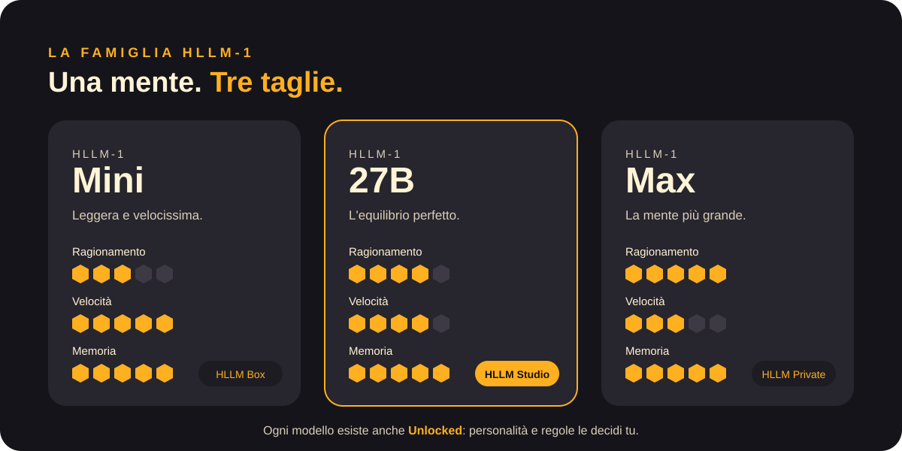

<a href="../en/models.md">English</a> · <b>Italiano</b>

# Modelli

## La famiglia HLLM-1

Una mente, tre taglie. Hanno tutte la stessa memoria, lo stesso modo di pensare, lo stesso sonno: cambia quanto è grande la mente e quanto velocemente risponde.

| | Mini | 27B | Max |
|---|---|---|---|
| Ideale per | Aiuto quotidiano, la casa | Lavoro, studio, progetti creativi | Problemi difficili, ricerca, grandi progetti |
| Ragionamento | ●●●○○ | ●●●●○ | ●●●●● |
| Velocità | ●●●●● | ●●●●○ | ●●●○○ |
| Memoria | Senza limiti | Senza limiti | Senza limiti |
| Macchina | HLLM Box | HLLM Studio | HLLM Private |

Il numero nel nome (HLLM-**1**) è la generazione della nostra architettura. Ogni nuova generazione porta un nuovo modo di pensare.

## Standard o Unlocked?

I modelli **Standard** seguono regole sicure ed equilibrate, pensate per tutta la famiglia, bambini compresi. Sono gentili e attenti.

I modelli **Unlocked** lasciano le regole a te. Scegli:
- la **personalità**: un mentore calmo, un allenatore severo, un amico ironico;
- il **tono**: formale, diretto, giocoso;
- le **regole**: di cosa può parlare, quanto può essere schietto.

Unlocked è disponibile **solo sulle macchine di tua proprietà**, per uso privato domestico, mai sulle macchine in abbonamento. Quando la macchina è tua, sei tu a rispondere di come la usi.

[← Documentazione](README.md)
