<a href="../en/security-and-privacy.md">English</a> · <b>Italiano</b>

# Sicurezza e privacy

- **I tuoi dati restano a casa.** Su una macchina di tua proprietà, niente di ciò che dici esce, a meno che tu non chieda a HLLM di cercare sul web.
- **Mai usati per addestrare.** Le tue conversazioni e i tuoi file non addestrano nessun modello, nemmeno il nostro.
- **Crittografia end-to-end.** Fra il tuo telefono o computer e la tua macchina tutto è cifrato. Le chiavi le hanno solo la tua app e la tua macchina.
- **Codici che si rigenerano.** Ogni connessione richiede un codice che cambia ogni pochi secondi, sia sull'app sia sulla macchina. Senza, la connessione non parte.
- **Dedicata, mai condivisa.** Una macchina in abbonamento è solo tua per tutta la durata dell'abbonamento.
- **5 anni di aggiornamenti di sicurezza** per ogni macchina acquistata.
- **Unlocked con responsabilità.** I modelli Unlocked girano solo sulle macchine di tua proprietà, per uso privato domestico.

[← Documentazione](README.md)
