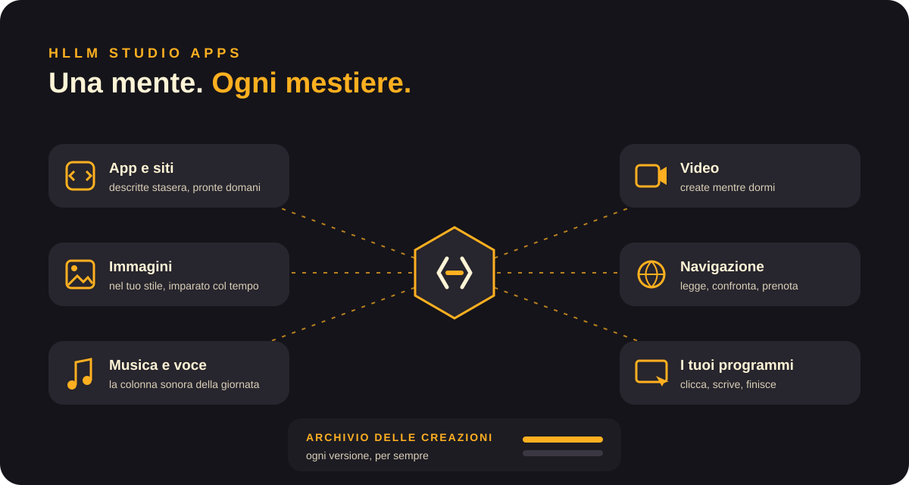

<a href="../en/studio-apps.md">English</a> · <b>Italiano</b>

# HLLM Studio Apps: una mente, ogni mestiere

HLLM non è un'app. È **una mente che cambia mestiere**: costruisce, disegna, compone, gira video, naviga e usa i tuoi programmi. Tutte le app condividono la stessa memoria, gli stessi gusti, lo stesso te.

## I mestieri

| | Cosa dici | Cosa ottieni |
|---|---|---|
| **App e siti** | «Mi serve un'app per seguire le mie piante.» | Un'app funzionante sul telefono, domattina. Migliora mentre la usi. |
| **Immagini** | «Un logo per la mia pasticceria, caldo, un po' retrò.» | Dieci proposte nel tuo stile, rifinite partendo dalle tue preferite. |
| **Musica e voce** | «Qualcosa di calmo per lavorare, come domenica scorsa.» | Una colonna sonora infinita che segue la tua giornata. |
| **Video** | «Trasforma le foto della vacanza in un film di due minuti.» | Montato, con musica e voce, pronto al tuo risveglio. |
| **Navigazione** | «Trova un volo sotto i 200 € e prenotalo se è diretto.» | Confrontato, scelto, prenotato. Ti chiede solo l'ok finale. |
| **I tuoi programmi** | «Metti questi scontrini nel mio foglio di calcolo.» | Apre il programma, clicca, scrive e finisce il lavoro. |

## L'archivio delle creazioni

Tutto ciò che HLLM crea resta, **ogni versione, per sempre**, sulla tua macchina.
> «Riprendi il logo di marzo, ma più caldo.»

È il controllo delle versioni per tutta la tua vita creativa.

## Modalità sogno

Di notte la scheda video è libera, e HLLM la usa. Finisce i rendering lunghi e rifinisce i tuoi progetti, e prepara **sorprese** per il mattino:
- un film di 60 secondi della tua settimana;
- una canzone fatta con le note di oggi;
- l'app che hai descritto a cena, pronta da provare.

## Le idee che stiamo inseguendo

- **App vive.** Le app che HLLM costruisce per te osservano come le usi e si evolvono di notte. I pulsanti inutili spariscono, quelli che mancano compaiono.
- **Mostraglielo una volta.** Fai un lavoro una volta mentre HLLM guarda. Capisce i passaggi e da quel momento lo fa lui.
- **La casa come una tela.** Luci, musica e schermi seguono l'atmosfera della stanza, composti dal vivo.
- **Sciami di agenti.** Una domanda, cento piccoli agenti HLLM in parallelo durante la notte, ognuno su un'idea diversa. Al mattino ti arrivano le tre migliori.
- **Un corso personale da qualsiasi libro.** Gli dai un libro, e costruisce lezioni, quiz, schemi e brevi video al tuo ritmo.
- **Inventa un gioco, giocaci stasera.** Lo descrivi a pranzo, ci giochi dopo cena, e chiedi modifiche mentre giochi.
- **Menti di famiglia che si parlano.** Gli HLLM di casa organizzano insieme una cena o un viaggio. Condividono solo ciò che permetti, e niente esce mai di casa.
- **Abilità, non dati.** Condividi con gli amici un'abilità che il tuo HLLM ha imparato, come «come monto i miei podcast», senza condividere nemmeno un file.
- **Un secondo cervello sul muro.** Uno schermo e-ink tranquillo in casa: il piano di oggi, cosa sta facendo HLLM, cosa aspetta te.
- **Compagno di riparazioni.** Inquadri con il telefono l'oggetto rotto e ricevi un aiuto passo per passo, con le frecce disegnate sull'immagine.
- **Viaggio nel tempo per tutto.** Qualsiasi documento, progetto o impostazione: «com'era martedì scorso?»
- **Un cervello, tanti schermi.** Inizi un lavoro sulla TV, lo continui sul telefono, lo finisci alla scrivania. La mente segue te, non il dispositivo.

## Come è possibile su una sola macchina

Una sola scheda video deve fare da **mente** e da **studio creativo**, e HLLM dirige l'orchestra. Quando serve un'immagine o un video, la mente si fa da parte e presta la scheda, poi se la riprende. I lavori lunghi girano nelle ore tranquille, e quando qualcosa è pronto, o serve il tuo ok, ricevi una schermata effimera.

[← Documentazione](README.md)
