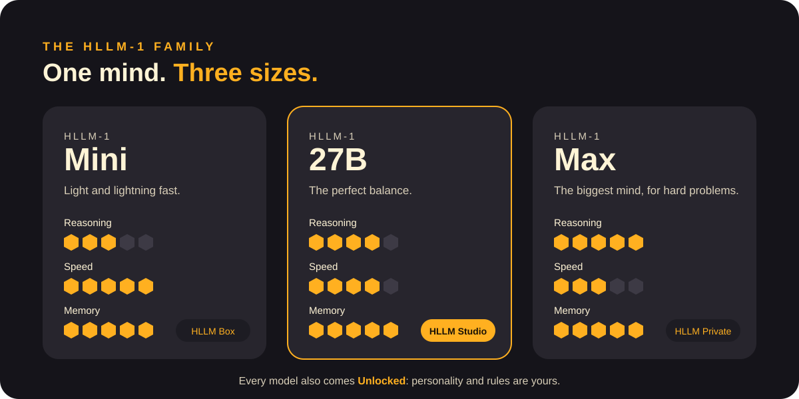

# Models

## The HLLM-1 family

One mind, three sizes. Each has the same memory, the same way of thinking, the same sleep: what changes is how big the mind is and how fast it answers.

| | Mini | 27B | Max |
|---|---|---|---|
| Best for | Everyday help, the home | Work, study, creative projects | Hard problems, research, big projects |
| Reasoning | ●●●○○ | ●●●●○ | ●●●●● |
| Speed | ●●●●● | ●●●●○ | ●●●○○ |
| Memory | Unlimited | Unlimited | Unlimited |
| Machine | HLLM Box | HLLM Studio | HLLM Private |

The number in the name (HLLM-**1**) is the generation of our architecture. Each new generation brings a new way of thinking.

## Standard or Unlocked?

**Standard** models follow safe, balanced rules designed for everyone at home, kids included. They are polite and careful.

**Unlocked** models give the rules to you. You choose:
- the **personality**: a calm mentor, a strict coach, an ironic friend;
- the **tone**: formal, direct, playful;
- the **rules**: what it may talk about, how blunt it can be.

Unlocked is available **only on machines you own**, for private home use, and never on rented machines. When you own the machine, you are responsible for how you use it.

[← Documentation](README.md)
